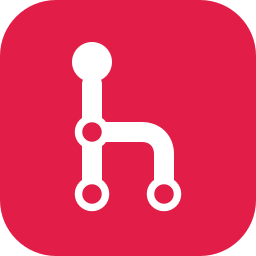

<p align="center">
  
</p>

<h1 align="center">Headway</h1>

<p align="center">A fast, friendly native Git client — with workspaces.</p>

Headway is a desktop Git client for Linux, macOS and Windows. It groups the repositories you work on together into **workspaces**, so you can see all of them at once and jump between them in tabs. It's a single native program, written in Rust with [egui](https://github.com/emilk/egui), and it runs the `git` already on your computer, so it uses your existing settings, keys and logins.

## Features

- **Workspaces** — named groups of repositories with an overview of each one's branch, changes and ahead/behind state; fetch or pull them all at once. Add one repository, every repository in a folder, or clone from a web address.
- **History graph** — coloured branch lanes, search (Ctrl+F), and branches you can hide from the graph.
- **Syntax highlighting** — diffs and blame coloured by language (about 200 of them), with each side of a change read as a whole file so multi-line strings and comments come out right.
- **Image previews** — changed pictures (PNG, JPEG, GIF, WebP, BMP, ICO, SVG) shown before and after, side by side.
- **Staging** — every changed file stacked in one view; stage, unstage or discard whole files, hunks, or individual lines (click, shift-click or drag). Fold files, or collapse and expand them all.
- **Merge conflicts** — a banner while a merge, rebase, cherry-pick or revert is in progress, with Continue, Abort and Skip. Walk through every conflict in the repository one at a time (Alt+↑/↓), taking either side (Alt+←/→), both, or your own edit, with the real branch names, line numbers, the common ancestor and a preview of the result; save every resolved file at once, or open your configured merge tool.
- **Blame and history** — who last changed each line, coloured by age; click through to the commit, or blame the line's parent to look past a reformat. History of a file (across renames), a folder, or just a few lines. Ctrl+P finds any file.
- **Commits** — commit, amend, and edit the message of any earlier commit; later commits and every branch, tag and worktree pointing at them move along in one step.
- **Undo** — Ctrl/Cmd+Z takes back commits, amends, resets, merges, rebases, checkouts, branch deletes, stash drops and discarded files, hunks or lines, and says why when it isn't safe. A **reflog** view finds lost commits and gets you back to them.
- **Branches, tags, remotes, stashes, worktrees and submodules** — all in the sidebar, with the usual actions on a right-click.

## Install

Downloads for every platform are on the [releases page](https://github.com/cnu/headway/releases). Headway needs `git` installed and on your `PATH`.

| Platform | Download | Or install with |
|---|---|---|
| macOS (Apple silicon and Intel) | `.dmg` | `brew install --cask cnu/tap/headway` |
| Windows (x86_64) | `.msi` installer, or `.zip` | |
| Debian, Ubuntu | `.deb` | `sudo apt install ./headway_*.deb` |
| Fedora, openSUSE, RHEL | `.rpm` | `sudo dnf install ./headway-*.rpm` |
| Arch Linux | | `yay -S headway-bin` (AUR) |
| Any Linux (x86_64, arm64) | `.AppImage`, or `.tar.gz` | `brew install --cask cnu/tap/headway` |

The macOS and Windows builds aren't code-signed yet. On macOS, open Headway the first time with right-click → **Open**; on Windows, choose **More info → Run anyway** if SmartScreen warns.

### Build from source

```bash
cargo install --git https://github.com/cnu/headway
```

On Linux, `assets/linux/install.sh` adds a desktop entry and icons for your user, so app launchers and Wayland compositors show Headway's icon. Pass it the path to the `headway` binary:

```bash
./assets/linux/install.sh ~/.cargo/bin/headway
```

## Development

```bash
cargo run
```

Development (debug) builds open a **Sample Projects** workspace on first launch: four small repositories with branches, a merge, a tag, uncommitted changes and a merge stopped on conflicts, created under your data folder (`~/.local/share/headway/samples` on Linux). Reset one with "Reset sample project…" in its menu on the overview, or:

```bash
cargo run -- --reset-sample web-shop
```

Release builds leave the samples out entirely and start with an empty workspace.

Settings and workspaces are saved to `workspaces.json` in your config folder (`~/.config/headway` on Linux). The undo log is kept per repository in `undo/` under your data folder (`~/.local/share/headway/undo` on Linux).

### Tests

```bash
cargo test
```

The tests include click-through tests that drive the real app headlessly with [egui_kittest](https://github.com/emilk/egui/tree/main/crates/egui_kittest). `./coverage.sh` measures coverage (it needs the `llvm-profdata` and `llvm-cov` matching your Rust toolchain).

### App icon

The icon's sources are in `assets/brand`. After changing `build_icons.py`, regenerate every variant and the exported PNG, `.ico` and `.icns` files (needs `rsvg-convert` and ImageMagick):

```bash
python3 assets/brand/build_icons.py
```

### Releasing

Bump `version` in `Cargo.toml`, rename the **Unreleased** section of [CHANGELOG.md](CHANGELOG.md) to the new version and date (it becomes the release notes), commit, then push a matching tag:

```bash
git tag -a v0.2.0 -m "Headway 0.2.0" && git push origin main v0.2.0
```

The [release workflow](.github/workflows/release.yml) builds every platform, publishes a GitHub release with checksums, and updates the Homebrew cask in [cnu/homebrew-tap](https://github.com/cnu/homebrew-tap).

## License

Headway is licensed under either of [Apache License, Version 2.0](LICENSE-APACHE) or [MIT license](LICENSE-MIT), at your option.
